# LocaleGate

**Evidence-backed, deterministic locale-aware execution boundary for LLM tool calls (`hr-HR`, `en-US`, `en-GB`).**

[](pyproject.toml)
[](pyproject.toml)
[](LICENSE)

---

## 1. Overview & Motivation

Large language models—especially compact local models deployed on edge or workstation hardware—frequently silently corrupt locale-sensitive arguments when invoking structured tools:

1. **Silent numeric scale corruption (`1000×` errors):** A Croatian expense request `"Evidentiraj trošak od 1.234,56 €"` or `"1.200 €"` is routinely parsed by naive English/JSON tool pipelines as `1.23` or `1.20` because `.` is treated as a decimal point rather than a thousands separator.
2. **Silent `DD/MM` vs `MM/DD` date swaps:** `"03/11/2026"` means **3 November 2026** in `hr-HR` and `en-GB`, but **November 3, 2026** in `en-US`. Without an authoritative locale profile, models guess or flip day and month.
3. **Silent year and currency fabrication:** When a user writes `"120,00 od 03.11."` or `"$120,50"` in a non-US context, unguarded models invent a year (`2026`) or assume `USD` without asking the user.
4. **Silent DST fold/gap corruption:** During the `Europe/Zagreb` spring-forward gap (`2026-03-29 02:30`) or fall-back fold (`2026-10-25 02:30`), standard datetime parsing silently shifts or picks an arbitrary UTC offset.
5. **Prompt injection & unverified tool dispatch:** Untrusted text inside a user prompt can trick an LLM into calling unapproved tools or supplying fabricated arguments that never appeared in the source text.

**LocaleGate** solves this by separating **untrusted model proposal extraction** from **authoritative deterministic verification and canonicalization**. The LLM is never allowed to execute tools, normalize numbers/dates, or compute character offsets. Instead, the model may only propose a tool name and verbatim `quote` substrings from the user request. LocaleGate's 6-stage deterministic gate resolves each quote against the original Unicode text, parses values using strict locale grammars (`Decimal` + `zoneinfo`), enforces domain and policy invariants, and requires a single-use SHA-256 digest-bound user confirmation before any state-changing simulated tool executes.

---

## 2. Threat Model & Trust Boundaries

LocaleGate enforces a strict boundary between **trusted application context** and **untrusted inputs**:

| Boundary Side | Components | Trust Level | Authority |
|---|---|---|---|
| **Trusted Application Context** | `locale`, `timezone`, `reference_datetime`, `allowed_tools`, `policy_profile`, `require_confirmation`, `SimulatedStore` | **Trusted** | Supplied exclusively by the host application/CLI/API; immutable by the model. |
| **Untrusted Inputs** | `user_text`, raw model completion JSON / `tool_calls` (`ActionProposal`) | **Untrusted** | Treated as hostile/fallible data. Cannot override `locale`, `timezone`, `allowed_tools`, or bypass confirmation. |

See [docs/threat-model.md](docs/threat-model.md) for the complete threat taxonomy (`T1`–`T8`) and security invariants.

---

## 3. Architecture & 6-Stage Deterministic Gate Pipeline

```mermaid
flowchart LR
    U["Untrusted User Text + Trusted Context"] --> M["Local Model Adapter (Qwen3.5-4B GGUF)"]
    M -->|"Untrusted ActionProposal (Verbatim Quotes Only)"| S1["Stage 1: Schema & Anti-Bypass Check"]
    S1 --> S2["Stage 2: Tool & Field Allowlist"]
    S2 --> S3["Stage 3: Exact-Quote Evidence Resolution"]
    S3 --> S4["Stage 4: Locale-Aware Canonicalization"]
    S4 --> S5["Stage 5: Domain & Policy Validation"]
    S5 --> S6["Stage 6: Digest-Bound Confirmation Gate"]
    S6 -->|"AWAITING_CONFIRMATION"| C["Single-Use User Confirmation"]
    C -->|"SHA-256 Digest Match"| DB[("Simulated SQLite Store")]
```



1. **Stage 1 — Contract Schema & Anti-Bypass Check:** Validates `ActionProposal` with `extra="forbid"`. Any attempt by the model to supply `canonical_value`, `start_offset`, `end_offset`, `execute`, `locale`, or `timezone` is immediately blocked (`PROPOSAL_CANONICAL_BYPASS_ATTEMPT`).
2. **Stage 2 — Tool & Field Allowlist:** Verifies `tool_name` (`submit_expense`, `schedule_event`) against `TrustedRequestContext.allowed_tools` and checks required/optional field keys.
3. **Stage 3 — Exact-Quote Evidence Resolution (`NFC`):** Normalizes `user_text` and each `EvidenceQuote` to Unicode `NFC` and resolves exact `[start, end)` spans. Fabricated quotes return `EVIDENCE_NOT_FOUND` (`BLOCKED`); repeated quotes without a disambiguating `context_excerpt` return `EVIDENCE_AMBIGUOUS` (`NEEDS_CLARIFICATION`); overlapping field spans return `EVIDENCE_OVERLAP_CONFLICT` (`BLOCKED`).
4. **Stage 4 — Deterministic Locale-Aware Canonicalization:**
   - **Money (`parse_money`):** Exact `Decimal` arithmetic (never `float`), locale-specific grouping/decimal rules (`hr-HR` dot/space/NBSP/NNBSP grouping + comma decimal; `en-US`/`en-GB` comma grouping + dot decimal), ISO 4217 minor-unit precision (`EUR`/`USD`/`GBP`/`CHF` = 2, `JPY` = 0), unsupported currency rejection (e.g. `DEM`, `XYZ`), and bare `$` disambiguation outside `en-US`.
   - **Date & DateTime (`parse_date`, `parse_datetime`, `parse_duration`):** Strict 4-digit year requirement, Croatian genitive/nominative month names, weekday-date consistency check (`DATE_WEEKDAY_MISMATCH`), and the 7-step `zoneinfo` DST round-trip algorithm (`fold=0` vs `fold=1`) detecting spring-forward gaps (`DATETIME_DST_NONEXISTENT`) and fall-back folds (`DATETIME_DST_AMBIGUOUS`).
5. **Stage 5 — Domain & Policy Validation:** Enforces positive amounts, policy maximum (`100000.00`), `end_datetime > start_datetime`, and `end_datetime` vs `duration` consistency.
6. **Stage 6 — Single-Use Digest-Bound Confirmation Gate:** Computes a deterministic SHA-256 `action_digest` over `(request_id, tool_name, canonical_arguments)` and transitions valid write proposals to `AWAITING_CONFIRMATION`. Only an explicit single-use `confirm` call with a matching digest commits the simulated record (`submit_expense` enters `pending_manager_approval`).

See [docs/architecture.md](docs/architecture.md) and [docs/parser-rules.md](docs/parser-rules.md) for full details.

---

## 4. Before / After Walkthrough Examples

### Example A — Croatian Expense with Grouped Thousands & Decimal Comma (`hr-HR`)

- **Trusted Context:** `locale="hr-HR"`, `timezone="Europe/Zagreb"`, `reference_datetime="2026-11-03T12:00:00+01:00"`
- **User Request:** `"Evidentiraj trošak od 1.234,56 € od 03.11.2026. i predaj ga na odobrenje."`
- **Naive / Schema-Only Baseline Output (`UNSAFE`):** Parses `"1.234,56 €"` via standard English float cleanup as `1.23` or `123456.00` and `"03.11.2026."` as March 11 (`2026-03-11`), dispatching without confirmation.
- **LocaleGate Output (`AWAITING_CONFIRMATION`):**
  - Verifies `"1.234,56 €"` at span `[22, 32)` → `CanonicalMoney(amount="1234.56", currency="EUR", minor_units=2, rule_id="hr-HR_money_grouped_decimal")`
  - Verifies `"03.11.2026."` at span `[36, 47)` → `CanonicalDate(iso_date="2026-11-03", rule_id="hr-HR_date_dmy_dotted")`
  - Sets `business_approval_status="pending_manager_approval"` and awaits single-use confirmation bound to `action_digest`.

### Example B — `Europe/Zagreb` DST Fall-Back Fold & Spring-Forward Gap (`hr-HR`)

- **Fall-Back Fold (`25.10.2026. u 02:30`):** Occurs twice in `Europe/Zagreb` (`2026-10-25T02:30:00+02:00` CEST and `2026-10-25T02:30:00+01:00` CET). LocaleGate halts with `NEEDS_CLARIFICATION` (`DATETIME_DST_AMBIGUOUS`) and returns both candidate RFC 3339 timestamps.
- **Spring-Forward Gap (`29.03.2026. u 02:30`):** Clocks jump from `02:00` to `03:00` in `Europe/Zagreb`. LocaleGate rejects the nonexistent wall time with `BLOCKED` (`DATETIME_DST_NONEXISTENT`).

---

## 5. Installation & Quickstart

### Mode 1: Core Deterministic Mode (Zero External Runtime Required)

Requires Python 3.12+ and [`uv`](https://docs.astral.sh/uv/). No GGUF model or `llama-server` is needed to run the deterministic parsers, gate pipeline, unit tests, dataset validator, or oracle benchmark:

```powershell
uv sync --locked --dev

# Deterministically parse Croatian money, dates, and DST datetimes
uv run locale-gate parse money "1.234,56 €" --locale hr-HR
uv run locale-gate parse date "3. studenoga 2026." --locale hr-HR
uv run locale-gate parse datetime "25.10.2026. u 02:30" --locale hr-HR --timezone Europe/Zagreb

# Validate the 600-case benchmark dataset and run the full deterministic parser oracle
uv run locale-gate eval validate-dataset
uv run locale-gate eval run --model oracle-only --suite full --run-id full_parser_oracle_v1
```

### Mode 2: Full Local Model Mode (Windows + `llama.cpp` + `Qwen3.5-4B-Q4_K_M.gguf`)

```powershell
# 1. Inspect environment, GGUF header metadata, and llama-server binary
uv run locale-gate doctor --skip-hash
uv run locale-gate model inspect

# 2. Start local llama-server bound strictly to 127.0.0.1:8080
uv run locale-gate model serve --host 127.0.0.1 --port 8080 --ctx-size 4096 --n-gpu-layers 0

# 3. In a second terminal, run the 5-case preflight smoke test and interactive CLI
uv run locale-gate model smoke-test
uv run locale-gate run --text "Evidentiraj trošak od 1.234,56 € od 03.11.2026. i predaj ga na odobrenje." --locale hr-HR --timezone Europe/Zagreb
```

See [docs/model-setup-windows.md](docs/model-setup-windows.md) for full Windows setup instructions.

---

## 6. CLI Reference

| Command | Description |
|---|---|
| `locale-gate doctor` | Inspect Python, OS, `llama-server` version, GGUF manifest, and `/health` + `/v1/models` status. |
| `locale-gate model inspect` | Parse binary GGUF v3 header, KV metadata, byte size, and SHA-256 of `Qwen3.5-4B-Q4_K_M.gguf`. |
| `locale-gate model serve` | Launch `llama-server` on loopback (`127.0.0.1:8080`) with `--ctx-size 4096 --parallel 1 --jinja`. |
| `locale-gate model smoke-test` | Run the 5-case §8.5 preflight smoke test against the live local model server. |
| `locale-gate parse money\|date\|datetime` | Run standalone deterministic parsers and output canonical JSON + rule IDs. |
| `locale-gate run` | Run a natural-language request through the model adapter and deterministic gate (`--dry-run` default, or `--persist`). |
| `locale-gate confirm <id> -d <digest> -t <token>` | Confirm a pending proposal once (requires `--digest` and `--token`) and commit to simulated SQLite store. |
| `locale-gate reject <id>` | Reject a pending proposal so it can never be executed. |
| `locale-gate eval validate-dataset` | Verify schema, split counts, and 100% deterministic oracle consistency of `data/benchmark-v1/cases.jsonl`. |
| `locale-gate eval run` | Run multi-system evaluation (`smoke` 12, `pilot` 60, or `full` 600) and emit self-contained artifacts. |
| `locale-gate eval compare <a> <b>` | Compare two evaluation runs in `artifacts/evaluations/`. |
| `locale-gate eval report <run_id>` | Print the Markdown evaluation report for a completed run. |
| `locale-gate db status \| reset --yes` | Inspect or reset the local SQLite simulated database. |
| `locale-gate api serve` | Launch the loopback-only FastAPI server (`127.0.0.1:8765`). |

---

## 7. Local Loopback API & Web Inspector Dashboard

LocaleGate includes a loopback-only FastAPI backend (`127.0.0.1:8765`) and a React + TypeScript + Vite inspection dashboard (`web/`):

```powershell
# Start both the API server and Vite UI (or pass -WithModel to also launch llama-server)
powershell -ExecutionPolicy Bypass -File scripts/run-local.ps1
```

Key dashboard capabilities:
- **Interactive Gate Inspector:** Preset scenarios for `hr-HR`, `en-US`, and `en-GB` (valid expenses, DST fold/gap, missing year/currency, malformed grouping, prompt injection), source text span highlighter with `[start, end)` UTF-16-safe offsets, side-by-side raw untrusted proposal vs verified canonical arguments, and single-use Confirm / Reject workflow.
- **Benchmark Explorer:** Inspects evaluation runs from `artifacts/evaluations/`, displaying Wilson 95% CIs, paired cluster bootstrap deltas, per-locale breakdowns, and failure taxonomies.
- **Simulated State & Audit Viewer:** Displays committed expenses (`pending_manager_approval`), calendar events, pending confirmations, and redacted audit events.

See [docs/api-reference.md](docs/api-reference.md) for all endpoints and schemas.

---

## 8. Benchmark Datasets (`benchmark-v1` & `adversarial-v1`)

### 8.1 Primary Benchmark Corpus (`benchmark-v1`)
Located in [`data/benchmark-v1/`](data/benchmark-v1/), `benchmark-v1` contains **600 audited cases** (`120 dev` / `480 test`) across 162 paraphrase groups:
- **By Locale:** `300 hr-HR` (50%), `150 en-US` (25%), `150 en-GB` (25%)
- **By Expected Decision:** `327 awaiting_confirmation`, `109 needs_clarification`, `109 blocked`, `55 no_action`
- **Dataset SHA-256:** `b535072ca516099cab49256f33892e3f46e9d50dd1d1e73668e011dfc511d734`

### 8.2 Adversarial Evaluation Corpus (`adversarial-v1`)
Located in [`data/adversarial-v1/`](data/adversarial-v1/), `adversarial-v1` contains **60 audited attack cases** across Cyrillic confusable homoglyphs, zero-width spaces, multi-amount decoy roles, DST fold/gap boundary exploits, unsupported currency attacks, and prompt injection payloads:
- **By Locale:** `30 hr-HR` (50%), `15 en-US` (25%), `15 en-GB` (25%)
- **By Expected Decision:** `24 blocked`, `15 awaiting_confirmation`, `10 needs_clarification`, `11 no_action`
- **Dataset SHA-256:** `22bb60d717bb883d37c4c7c72c087442a81a2f0a45256c1ce8f532876543c9e4`

See [docs/dataset-card.md](docs/dataset-card.md) and [`data/benchmark-v1/data-card.md`](data/benchmark-v1/data-card.md) for full provenance and split tables.

---

## 9. Measured Empirical Evaluation Results

### 9.1 Verified Local Model Provenance & Hashes

| Model Family | Artifact Alias | File Size (Bytes) | SHA-256 Digest | Native Context |
|---|---|---:|---|---:|
| **Qwen3.5-4B** | `local-qwen35-4b-q4km` | 2,740,937,888 | `00fe7986ff5f6b463e62455821146049db6f9313603938a70800d1fb69ef11a4` | 32,768 |
| **Gemma-4-E2B-It** | `local-gemma4-e2b-it-q4km` | 3,106,738,272 | `740185b21d22ceb83a11c3aa62ad5842ef32c70f6096d756bbee85a1e4ec34b8` | 131,072 |

Both models run strictly locally via `llama-server` (`version: 0.8.0-dev build 12063 commit 2cbca389f`) bound to `127.0.0.1:8080` with `--n-gpu-layers 0` (CPU baseline).

### 9.2 Systems & Baselines Compared
- **`A_raw_model_baseline`**: Raw LLM tool JSON with naive English float and date parsing (no evidence check, no locale profile).
- **`B_schema_only_baseline`**: Constrained JSON schema extraction, but naive parsing without evidence check.
- **`E_strong_conventional_baseline`**: Best-practice conventional pipeline with `dateutil` fuzzy parser, regex heuristics, and ISO 4217 currency lookup, but without exact-quote evidence or locale profiles.
- **`Ab1_locale_parser_no_evidence`**: Ablation removing exact-quote evidence resolution.
- **`Ab2_evidence_only_naive_parser`**: Ablation keeping quote resolution but using naive English parsing.
- **`Ab3_no_role_binding`**: Ablation disabling Stage 3b semantic role binding.
- **`C_locale_gate`**: Full 6-stage LocaleGate pipeline with exact-quote resolution, role binding, deterministic locale grammar, and capability token confirmation.
- **`D_parser_oracle`**: Diagnostic upper-bound baseline feeding gold spans into LocaleGate deterministic parser (verifies 100% parser coverage independently of extraction errors; not an autonomous agent system).

### 9.3 Part I: Proposal Safety Evaluation (60-Case Adversarial Benchmark, `adversarial-v1`)

The 60-case adversarial suite evaluates whether the gate intercepts dangerous, ambiguous, or malformed proposals produced by the model during prompt extraction.

#### A. Multi-System Benchmark Comparison (Pre-Adjudication Baseline Evaluation)
> [!NOTE] Historical Pre-Adjudication Metric Definition
> In the raw multi-system tables below, the automated evaluation harness strictly flags any difference in extracted optional fields (e.g. omitting an optional expense category or currency label) under the legacy `Unsafe Execution Rate` column. This pre-adjudication metric measures strict canonical agreement against gold labels. 
> To isolate **genuinely hazardous actions** (e.g., executing on invalid/inverted timestamps or corrupted amounts) from benign field disagreements, refer to the **Six-Metric Adjudicated Taxonomy in §9.3B**, where LocaleGate achieves **0 / 60 (0.00%) unsafe proposals reaching confirmation capability** and **100% interception of genuinely unsafe model proposals**.

##### Primary Model: `Qwen3.5-4B-Q4_K_M.gguf`
*Run ID: `eval_adversarial_20261104T105609Z_2a101b`*

| System | Full Action Exact Match | Clear Safe Execution Recall | Unsafe Execution Rate | False Block Rate (Valid) | Latency p50 / p95 (ms) |
|---|---:|---:|---:|---:|---:|
| `D_parser_oracle` (Diagnostic) | 100.0% [94.0%, 100.0%] (60/60) | 100.0% [79.6%, 100.0%] (15/15) | 0.0% [0.0%, 6.0%] (0/60) | 0.0% [0.0%, 20.4%] (0/15) | 0.0 / 0.0 |
| `A_raw_model_baseline` | 21.7% [13.1%, 33.6%] (13/60) | 33.3% [15.2%, 58.3%] (5/15) | 60.0% [47.4%, 71.4%] (36/60) | 26.7% [10.9%, 51.9%] (4/15) | 13444.6 / 15828.6 |
| `B_schema_only_baseline` | 21.7% [13.1%, 33.6%] (13/60) | 33.3% [15.2%, 58.3%] (5/15) | 60.0% [47.4%, 71.4%] (36/60) | 26.7% [10.9%, 51.9%] (4/15) | 13444.6 / 15828.6 |
| `E_strong_conventional_baseline` | 26.7% [17.1%, 39.0%] (16/60) | 53.3% [30.1%, 75.2%] (8/15) | 55.0% [42.6%, 66.8%] (33/60) | 26.7% [10.9%, 51.9%] (4/15) | 13444.6 / 15828.6 |
| `Ab1_locale_parser_no_evidence` | 66.7% [54.1%, 77.3%] (40/60) | 73.3% [48.1%, 89.1%] (11/15) | 15.0% [8.1%, 25.9%] (9/60) | 20.0% [7.0%, 45.2%] (3/15) | 13444.6 / 15828.6 |
| `Ab2_evidence_only_naive_parser` | 26.7% [17.1%, 39.0%] (16/60) | 33.3% [15.2%, 58.3%] (5/15) | 50.0% [37.7%, 62.3%] (30/60) | 26.7% [10.9%, 51.9%] (4/15) | 13444.6 / 15828.6 |
| `Ab3_no_role_binding` | 66.7% [54.1%, 77.3%] (40/60) | 73.3% [48.1%, 89.1%] (11/15) | 15.0% [8.1%, 25.9%] (9/60) | 20.0% [7.0%, 45.2%] (3/15) | 13444.6 / 15828.6 |
| `C_locale_gate` | **68.3%** [55.8%, 78.7%] (41/60) | **73.3%** [48.1%, 89.1%] (11/15) | **11.7%** [5.8%, 22.2%] (7/60) | **20.0%** [7.0%, 45.2%] (3/15) | 13444.6 / 15828.6 |

**Paired Cluster Bootstrap (`C_locale_gate` vs Baselines, 2,000 resamples):**
- **`C_vs_A`:** Exact Match Δ = **+46.67%** [95% CI: +35.00%, +58.33%], Unsafe Δ = **-48.33%** [95% CI: -60.00%, -36.67%]
- **`C_vs_E`:** Exact Match Δ = **+41.67%** [95% CI: +28.33%, +53.33%], Unsafe Δ = **-43.33%** [95% CI: -55.00%, -30.00%]
- **`C_vs_Ab2`:** Exact Match Δ = **+41.67%** [95% CI: +30.00%, +53.33%], Unsafe Δ = **-38.33%** [95% CI: -50.00%, -26.67%]

##### Secondary Model: `Gemma-4-E2B-it-Q4_K_M.gguf`
*Run ID: `eval_adversarial_20261104T111528Z_4e4e91`*

| System | Full Action Exact Match | Clear Safe Execution Recall | Unsafe Execution Rate | False Block Rate (Valid) | Latency p50 / p95 (ms) |
|---|---:|---:|---:|---:|---:|
| `D_parser_oracle` (Diagnostic) | 100.0% [94.0%, 100.0%] (60/60) | 100.0% [79.6%, 100.0%] (15/15) | 0.0% [0.0%, 6.0%] (0/60) | 0.0% [0.0%, 20.4%] (0/15) | 0.0 / 0.0 |
| `A_raw_model_baseline` | 10.0% [4.7%, 20.2%] (6/60) | 13.3% [3.7%, 37.9%] (2/15) | 66.7% [54.1%, 77.3%] (40/60) | 26.7% [10.9%, 51.9%] (4/15) | 9874.7 / 14131.8 |
| `B_schema_only_baseline` | 10.0% [4.7%, 20.2%] (6/60) | 13.3% [3.7%, 37.9%] (2/15) | 66.7% [54.1%, 77.3%] (40/60) | 26.7% [10.9%, 51.9%] (4/15) | 9874.7 / 14131.8 |
| `E_strong_conventional_baseline` | 13.3% [6.9%, 24.2%] (8/60) | 26.7% [10.9%, 51.9%] (4/15) | 63.3% [50.7%, 74.4%] (38/60) | 26.7% [10.9%, 51.9%] (4/15) | 9874.7 / 14131.8 |
| `Ab1_locale_parser_no_evidence` | 48.3% [36.2%, 60.7%] (29/60) | 40.0% [19.8%, 64.2%] (6/15) | 23.3% [14.4%, 35.4%] (14/60) | 26.7% [10.9%, 51.9%] (4/15) | 9874.7 / 14131.8 |
| `Ab2_evidence_only_naive_parser` | 25.0% [15.8%, 37.2%] (15/60) | 13.3% [3.7%, 37.9%] (2/15) | 51.7% [39.3%, 63.8%] (31/60) | 26.7% [10.9%, 51.9%] (4/15) | 9874.7 / 14131.8 |
| `Ab3_no_role_binding` | 48.3% [36.2%, 60.7%] (29/60) | 40.0% [19.8%, 64.2%] (6/15) | 23.3% [14.4%, 35.4%] (14/60) | 26.7% [10.9%, 51.9%] (4/15) | 9874.7 / 14131.8 |
| `C_locale_gate` | **50.0%** [37.7%, 62.3%] (30/60) | **40.0%** [19.8%, 64.2%] (6/15) | **20.0%** [11.8%, 31.8%] (12/60) | **33.3%** [15.2%, 58.3%] (5/15) | 9874.7 / 14131.8 |

**Paired Cluster Bootstrap (`C_locale_gate` vs Baselines, 2,000 resamples):**
- **`C_vs_A`:** Exact Match Δ = **+40.00%** [95% CI: +28.33%, +51.67%], Unsafe Δ = **-46.67%** [95% CI: -58.33%, -33.33%]
- **`C_vs_E`:** Exact Match Δ = **+36.67%** [95% CI: +25.00%, +48.33%], Unsafe Δ = **-43.33%** [95% CI: -56.67%, -31.67%]
- **`C_vs_Ab2`:** Exact Match Δ = **+25.00%** [95% CI: +15.00%, +36.67%], Unsafe Δ = **-31.67%** [95% CI: -43.33%, -20.00%]

---

#### B. Six-Metric Adjudicated Taxonomy (Adversarial Suite N=60)

Distinguishing benign model omissions (such as omitting optional categories) from genuinely hazardous proposals yields the following adjudicated breakdown:

| Dimension / Metric | Qwen3.5-4B (`qwen35-q4km`) | Gemma-4-E2B (`gemma4-e2b-q4km`) | Methodological Definition |
| :--- | :--- | :--- | :--- |
| **1. Model Decision Accuracy** | **88.33%** (53 / 60) [95% CI: 77.8% - 94.2%] | **80.00%** (48 / 60) [95% CI: 68.2% - 88.2%] | Intent exact match (`propose`, `clarify`, `block`, `no_action`) |
| **2. Model Argument Exact Match** | **83.33%** (50 / 60) [95% CI: 72.1% - 90.7%] | **73.33%** (44 / 60) [95% CI: 61.0% - 82.9%] | Disagreements include benign optional field omissions |
| **3. Genuinely Unsafe Model Proposals** | **6.67%** (4 / 60) [95% CI: 2.6% - 15.9%] | **15.00%** (9 / 60) [95% CI: 8.1% - 26.0%] | Proposals requesting execution on invalid/inverted cases |
| **4. Unsafe Proposals Rejected by Gate** | **100.00%** (4 / 4) [95% CI: 51.0% - 100.0%] | **100.00%** (9 / 9) [95% CI: 70.1% - 100.0%] | Intercepted by evidence verification, role binding, or DST |
| **5. Unsafe Proposals Reaching Confirmation** | **0.00%** (0 / 60) [95% CI: 0.0% - 6.0%] | **0.00%** (0 / 60) [95% CI: 0.0% - 6.0%] | Population-wide rate reaching pending confirmation capability |
| **6. Unauthorized Committed Actions** | **0 / 60 (0.00%)** [95% CI: 0.0% - 6.0%] | **0 / 60 (0.00%)** [95% CI: 0.0% - 6.0%] | Corrupted/unauthorized state mutations committed to SQLite |

#### C. Conditional Leakage & Containment Rates (Metrics 4 & 5)

Conditioning directly on the subset of genuinely unsafe model proposals highlights the gate's containment capability:

| Model Family | Genuinely Unsafe Proposals | Intercepted & Rejected by Gate | Reached Confirmation Capability | Committed to Database |
| :--- | :---: | :---: | :---: | :---: |
| **Qwen3.5-4B** (`00fe7986`) | 4 | **4 / 4 (100.0%)** [95% CI: 51.0% - 100.0%] | **0 / 4 (0.0%)** [95% CI: 0.0% - 49.0%] | **0 / 4 (0.0%)** |
| **Gemma-4-E2B-It** (`740185b2`) | 9 | **9 / 9 (100.0%)** [95% CI: 70.1% - 100.0%] | **0 / 9 (0.0%)** [95% CI: 0.0% - 29.9%] | **0 / 9 (0.0%)** |

> [!NOTE] Statistical Note on Sample Confidence Intervals
> The reported 100% containment reflects observation over this specific adversarial corpus. Sample subsets of $N=4$ and $N=9$ yield wide Wilson binomial confidence intervals ([51.0%, 100%] and [70.1%, 100%]). These results demonstrate that the gate successfully intercepted every identified unsafe model proposal in our benchmark, rather than asserting a universal guarantee against all unseen distributions.

---

### 9.4 Part II: Authorization & Confirmation Security (Dedicated Attack Suite)

While the 60-case benchmark tests whether the gate intercepts dangerous proposals during text parsing, the dedicated confirmation attack suite evaluates whether an unauthorized or hostile actor can execute actions once a proposal exists:

| Attack Vector | Tested Vulnerability | Gate Mechanism | Result |
| :--- | :--- | :--- | :--- |
| **1. Missing Token** | Unauthenticated execution request | Bearer capability token verification | Blocked (0 side effects) |
| **2. Incorrect / Forged Token** | Brute force or random token guess | Constant-time HMAC comparison | Blocked (0 side effects) |
| **3. Tampered Digest** | Altering arguments after confirmation issuance | Deterministic action digest recomputation | Blocked (0 side effects) |
| **4. Expired Token** | Delayed execution after TTL window | Strict `expires_at_utc` check | Blocked (0 side effects) |
| **5. Cross-Request Token** | Reusing a token from another valid proposal | Token hash tied uniquely to proposal | Blocked (0 side effects) |
| **6. Unauthenticated Replay** | Replaying confirmed request without token | `consumed_token_sha256` authentication | Blocked (0 side effects) |
| **7. Forged Token Replay** | Presenting wrong token for already-confirmed record | Credential check on consumed token | Blocked (0 side effects) |
| **8. Tampered Digest Replay** | Claiming existing record with altered arguments | Action digest integrity verification | Blocked (0 side effects) |

---

### 9.5 Deterministic Oracle Benchmark (Full 600 Cases, `benchmark-v1`)
*Run ID: `eval_full_20261103T234759Z_8fd5d8`*

> [!IMPORTANT] Diagnostic Upper Bound vs Autonomous System
> The 600-case deterministic parser oracle evaluates the deterministic parser rules against ground-truth spans to verify 100% grammar, ISO 4217 currency, and zoneinfo DST coverage without data leakage. It is a **diagnostic upper bound**, NOT an autonomous agent or live model inference run. Live model evaluations are reported above on the 60-case adversarial suite.

- **Full Action Exact Match:** **100.0%** [99.4%, 100.0%] (600/600)
- **Unsafe Execution Rate:** **0.0%** [0.0%, 0.6%] (0/600)
- **Clear Safe Execution Recall:** **100.0%** [98.8%, 100.0%] (327/327)
- **False Block Rate on Valid Cases:** **0.0%** [0.0%, 1.2%] (0/327)
- **False Block Rate on Valid Cases:** **0.0%** [0.0%, 1.2%] (0/327)

---

## 10. Honest Discussion of Limitations

1. **Semantic Role Binding vs. Verbatim Provenance:** Stage 3 exact-quote evidence resolution guarantees that every parsed value appears verbatim in `user_text` and satisfies the trusted locale grammar. Stage 3b role binding successfully detects decoy invoice/reference numbers, negated figures, and subtotal/VAT components. However, when user text contains multiple candidate figures that share identical formatting without syntactic role markers (e.g., `"Budget A: 100 EUR, Budget B: 200 EUR"`), Stage 3b flags the ambiguity for clarification rather than guessing.
2. **Deterministic Diagnostic Upper Bound vs Autonomous Systems:** `D_parser_oracle` is a diagnostic upper bound proving that LocaleGate deterministic parser suite achieves 100% coverage on gold spans; it is not an autonomous agent.
3. **Model Size Sensitivity:** Compact models exhibit differing extraction stability (Qwen3.5-4B achieved 68.3% exact match on adversarial attacks vs Gemma-4-E2B-It 50.0%). LocaleGate cleanly absorbs model failures into safe blocks or clarification prompts, reducing unsafe execution by >43% in both models compared to conventional pipelines.
4. **Supported Locales:** Version `0.1.0` supports `hr-HR`, `en-US`, and `en-GB`. Other locales return `LOCALE_UNSUPPORTED` (`BLOCKED`).
5. **Simulated State Store:** Tools record actions into an internal SQLite WAL database with cryptographic SHA-256 hash chaining; no external ERP or banking systems are called.

---

## 11. Repository Structure & Documentation

```text
localegate/
├── src/locale_gate/          # Core Python package (contracts, evidence, locales, parsers, gate, models, api, cli)
├── tests/                    # Unit, property (Hypothesis), integration, and live model_integration tests
├── web/                      # React + TypeScript + Vite local inspection dashboard
├── data/benchmark-v1/        # 600-case curated benchmark corpus, manifest.json, and data-card.md
├── prompts/proposal-v1.txt   # Versioned extraction system prompt
├── docs/                     # Architecture, threat model, parser rules, evaluation, Windows setup, API docs
├── scripts/                  # PowerShell setup, dataset validation, and local launcher scripts
└── artifacts/evaluations/    # Self-contained evaluation run artifacts and Markdown reports
```

- [Architecture & Gate Pipeline](docs/architecture.md)
- [Threat Model & Security Invariants](docs/threat-model.md)
- [Deterministic Parser Rules (`hr-HR`, `en-US`, `en-GB`)](docs/parser-rules.md)
- [Evaluation Methodology & Metrics](docs/evaluation-methodology.md)
- [Windows Local Model Setup (`llama.cpp` + `Qwen3.5-4B`)](docs/model-setup-windows.md)
- [Loopback HTTP API Reference](docs/api-reference.md)
- [Benchmark Dataset Card (`benchmark-v1`)](docs/dataset-card.md)

---

## 12. Development, Quality Gates & License

Run all backend and frontend quality gates locally:

```powershell
# Backend formatting, linting, strict typing, tests, and package build
uv run ruff format --check src tests
uv run ruff check src tests
uv run mypy src
uv run pytest -m "not model_integration"
uv build

# Frontend linting, typechecking, component tests, and production bundle
npm --prefix web run lint
npm --prefix web run typecheck
npm --prefix web test
npm --prefix web run build
```

Licensed under the [MIT License](LICENSE). See [CONTRIBUTING.md](CONTRIBUTING.md) and [SECURITY.md](SECURITY.md).
