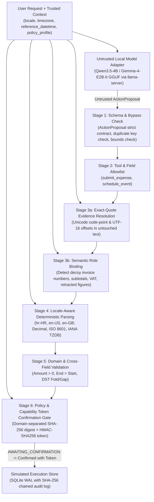

# Architecture & Trust Boundaries

## Overview

**LocaleGate** (`0.1.0`) is a deterministic verification and execution gate for local LLM tool calling. It enforces a strict architectural boundary between **probabilistic natural-language extraction** (performed by untrusted local models such as `Qwen3.5-4B-Q4_K_M.gguf` and `Gemma-4-E2B-it-Q4_K_M.gguf` via `llama.cpp`) and **authoritative parsing, canonicalization, role binding, policy validation, and execution** (performed exclusively by deterministic Python code).

## Core Invariants

1. **No Authoritative Model Values (`INV-01`):** The model may only emit `decision`, `tool_name`, `clarification_question`, and per-field verbatim evidence quotes (`quote` and optional `context_excerpt`). Any model attempt to emit `canonical_value`, `start_offset`, `end_offset`, `execute`, or `approved` is immediately blocked (`PROPOSAL_CANONICAL_BYPASS_ATTEMPT`).
2. **Exact-Quote Code-Point Grounding (`INV-02`):** Every field quotation must exist verbatim in the untouched original user request text (`resolve_evidence_quote`). Offsets are reported in both Unicode code points and UTF-16 code units (for safe JavaScript / browser consumption). Grapheme clusters are preserved.
3. **Disjoint Semantic Spans (`INV-03`):** Distinct fields may not claim identical or overlapping character spans unless explicitly whitelisted (such as `amount` and `currency` sharing a single monetary span like `"1.234,56 €"`).
4. **Deterministic Semantic Role Binding (`INV-04`):** When multiple candidate numeric or date tokens exist in the text, Stage 3b verifies semantic role markers. Decoy invoice/reference numbers, VAT/subtotal components when a total is present, and negated figures are flagged with `ROLE_BINDING_CONFLICT` or `ROLE_BINDING_AMBIGUOUS`.
5. **Locale-Aware Canonicalization (`INV-05`):** Numbers and dates are parsed using explicit `LocaleProfile` rules (`hr-HR`, `en-US`, `en-GB`). Binary floating-point (`float`) is never used for monetary values; all amounts use exact `Decimal` arithmetic.
6. **Domain-Separated Capability Confirmation Gate (`INV-06`):** Validated actions transition to `AWAITING_CONFIRMATION` with a domain-separated SHA-256 `action_digest` (`"locale-gate:action-digest:v1"`) and a cryptographically signed single-use capability token (`HMAC-SHA256`). Confirmation requires both the valid token and matching digest, and is recorded to a tamper-evident SHA-256 hash-chained audit log.
